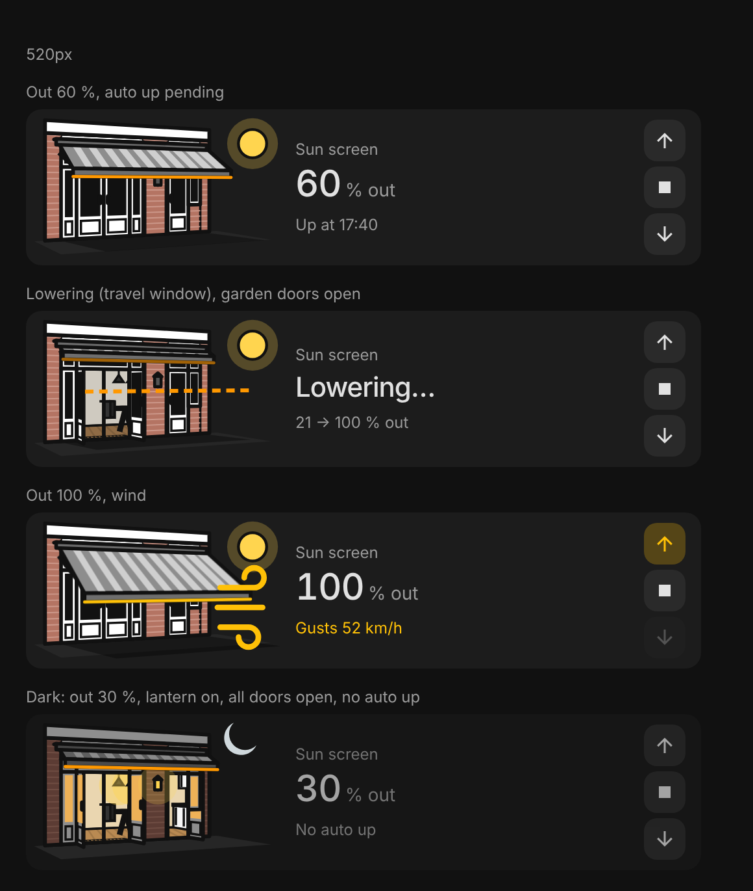

# Gardenview House

A Home Assistant dashboard card for the sun screen on the back of the house. Instead of an icon it draws the garden facade as a line drawing: the screen comes out at its real position, open doors show the room behind them, the garden lantern lights up, and the whole card dims when it gets dark.



It replaces a Mushroom cover card with card_mod. One JavaScript file, no dependencies, no card_mod, no Jinja.

## What it shows

| Part | Shows |
|---|---|
| The screen | At its real position, coming out at 30 degrees: solid grey cloth with light stripes, an orange hem while it is out, its shadow on the patio while the sun is up |
| Text | `60 % out`, `Retracted`, `Lowering…`, `Raising…` (with `45 → 100 % out` after a command from the card), `Unavailable` |
| Line under it | While out: `Up at 19:42` (the evening automation retracts the screen `retract_offset` minutes before sunset) or `No auto up` once that moment has passed for today. Retracted: sun elevation and outdoor temperature |
| Wind | Gusts of `wind_warning` km/h or more: yellow hem, wind lines, the cloth sways, `Gusts 52 km/h`, and the up button is highlighted while the screen is out |
| Doors | An open door swings out and shows the room behind it (dining room behind the French doors, kitchen behind the kitchen door) |
| Lantern | The pane lights up while the lantern is on |
| Dark | The house goes grey, the windows, rooms and lantern stay lit, the card dims a little. Sun or moon in the sky |

## Using it

| Do | Result |
|---|---|
| Tap up, stop or down | Retract, stop or lower the screen. Up is disabled when retracted and down when fully out (not while the screen travels); stop is always available. All three are disabled while the screen is unavailable |
| Drag the picture down or up | Set a position: down is further out, about 100 px of travel for the whole range, starting from where the screen is now. Snaps to 5 %, and to 0, 25, 50, 75 and 100 % close by. A dashed line shows the target; let go to send it |
| Tap the picture or the text | `tap_action` (default: more-info of the screen; signal strength is there, under the device) |
| Tap the lantern | `lantern_tap_action` (default: toggle) |
| Hold | `hold_action` / `lantern_hold_action` (default: more-info) |

Every action goes through Home Assistant's own action handler; the screen buttons and the drag are `perform-action` calls to `cover.open_cover`, `cover.close_cover`, `cover.stop_cover` and `cover.set_cover_position`.

Moving: motion_blinds never reports `opening` or `closing`. On a command it jumps straight to the target position and reports the real position when the motor stops. So the card treats the screen as travelling for `travel_time` (scaled by the distance) after its own command or after any position jump, draws it moving from the old to the new position, and shows `Lowering…` or `Raising…`. Positions polled while the motor runs move the estimate to the real position; when the travel ends, the card shows the last reported position. Covers that do report `opening` and `closing` work as well.

Position direction: for this screen (motion_blinds) 100 is open, which means retracted. The card shows it the way you see it: position 40 is `60 % out`.

## Install

Home Assistant 2026.11 and newer: Settings → Marketplace → Add from link → `https://github.com/BarBaar44/gardenview-house` (type Dashboard), then Install and reload the browser. The resource is served from `/local/community/gardenview-house/gardenview-house.js`.

Older Home Assistant: HACS → three dots → Custom repositories → the same link, category Dashboard.

## Configuration

```yaml
type: custom:gardenview-house
grid_options:
  columns: 12
  rows: 2
```

That is all for the owner's own house. Everything else is optional, in YAML or the visual editor. `null` switches a part off; a misspelled option or role gives an error card.

| Option | Default | |
|---|---|---|
| `name` | `Sun screen` | |
| `entities` | see below | |
| `wind_warning` | `40` | km/h gusts from which the card warns |
| `dark_below` | `10` | lx; only used when `dark` is an illuminance sensor (10 lx, the same as the Garden Lights automation) |
| `retract_offset` | `120` | minutes before sunset the evening automation retracts the screen; `null` hides `Up at` |
| `travel_time` | `15` | seconds the screen takes for the whole range (see below) |
| `tap_action`, `hold_action` | more-info | picture and text, on the screen entity |
| `lantern_tap_action`, `lantern_hold_action` | toggle, more-info | on the lantern entity |
| `colors` | `out` orange, `wind` amber | any CSS colour |

| Role | Default | |
|---|---|---|
| `cover` | `cover.sun_screen` | required; needs open, close and stop, set position for the drag |
| `sun` | `sun.sun` | sun or moon, elevation, next sunset |
| `temperature` | `sensor.outdoor_temperature` | |
| `wind_gust` | `sensor.openweathermap_wind_gust_speed` | km/h (m/s and mph are converted) |
| `dark` | `sensor.outdoor_sensor_illuminance` | a `binary_sensor`, `input_boolean` or `switch` (on = dark) or an illuminance sensor (below `dark_below`). Unavailable or `null`: dark while the sun is below the horizon |
| `lantern` | `light.rear_garden` | light or switch |
| `garden_door` | `binary_sensor.door_sensor_garden_doors_contact` | French doors; one sensor opens both leaves. Any device class works (on = open) |
| `garden_door_2` | none | second leaf of the French doors, if it has its own sensor |
| `kitchen_door` | `binary_sensor.door_sensor_kitchen_contact` | |

A full example is in [`gardenview-house.yaml`](gardenview-house.yaml).

## Design decisions

| Decision | Why |
|---|---|
| A drawing of the real facade instead of an icon | the card tells at a glance whether the screen is out, and the doors and lantern come along for free |
| Line art: white surfaces, bold black outlines, black glass | the same style as the car in the Tesla Model 3 Card; the ground floor wall is softened red brick with the white frames as edges, like the real wall |
| Camera about 25 degrees off straight on | at 45 degrees the open leaves cover the doorway and the room behind it does not show |
| Solid grey cloth, colour only in the hem | the real cloth is grey with light stripes; the orange hem says "out" without painting the whole picture |
| Drag on the picture instead of a slider | a slider looked like a light dimmer |
| Travel window instead of trusting `opening`/`closing` | motion_blinds jumps to the target at once and never reports moving; without it Stop was never enabled and the card never showed movement |
| Stop always enabled | stop_cover on a still screen is harmless, and the card cannot know for sure the motor has stopped |
| Relative drag, 100 px for the whole range | the front bar only moves about 40 px in the picture; following the finger exactly was too twitchy |
| "No auto up" once the retract moment has passed | the automation runs once, 2 h before sunset; a screen lowered after that stays out tonight |
| Dark dims the house, not the lights | the lit rooms and the lantern stand out |
| No garland or party decoration | out of scope: the picture stays about the screen, doors and lantern |

## Development

`npm install`, then `npm test` (jsdom). Check layout changes in a real browser at 360 and 520 px section width; the card must stay 120 px high (12 × 2).

MIT licence.
